  

### GitHub activity

### Contribution activity

<picture>
  <source media="(prefers-color-scheme: dark)" srcset="https://raw.githubusercontent.com/Aye-Shun/Aye-Shun/output/snake-dark.svg">
  
</picture>

  <a href="https://aye-shun.github.io/kenneth-park-portfolio/">Website & resume</a> &nbsp;·&nbsp;
  <a href="https://www.linkedin.com/in/kennethpark14">LinkedIn</a> &nbsp;·&nbsp;
  <a href="https://github.com/Aye-Shun?tab=repositories">Repositories</a>

I'm Kenneth, a Computer Science student at Rutgers with a Data Science minor. This is where I keep my small web apps, command-line tools, and other projects.

Previously a **Full-Stack Software Developer** with Rutgers CUPR's Data Informatics Group. Expected graduation: **January 2027**.

### Selected projects

- **[Portfolio & resume](https://github.com/Aye-Shun/kenneth-park-portfolio)** — My website, built with HTML, CSS, and a little JavaScript. [Open the site](https://aye-shun.github.io/kenneth-park-portfolio/).
- **[Lanewise](https://github.com/Aye-Shun/lanewise)** — A native macOS League of Legends companion with lobby scouting, match history, and an in-game overlay. Swift / SwiftUI.
- **[Focus Desk](https://github.com/Aye-Shun/focus-desk)** — A React timer with focus sessions, breaks, and a saved session count.
- **[Bookmark API](https://github.com/Aye-Shun/bookmark-api)** — Save and tag bookmarks with FastAPI and SQLite.
- **[CSV Quality Check](https://github.com/Aye-Shun/csv-quality-check)** — Check a CSV for missing cells, duplicate rows, and uneven columns. Python.
- **[Study Session CLI](https://github.com/Aye-Shun/study-session-cli)** — Log study time and see weekly totals by subject. Node.js.

[All repositories](https://github.com/Aye-Shun?tab=repositories), including Expense Ledger and Word Frequency CLI.

### Languages

  

### Frameworks & libraries

  

### Tools

  

### Games & music

Outside of development, I play League of Legends and listen to music.

Stats from <a href="https://www.deeplol.gg/summoner/na/Ecionisakiri-9767">deeplol.gg</a>. Not endorsed by Riot Games. League of Legends and Riot Games are trademarks or registered trademarks of Riot Games, Inc.

