  

### GitHub activity

### Contribution activity

<picture>
  <source media="(prefers-color-scheme: dark)" srcset="https://raw.githubusercontent.com/Aye-Shun/Aye-Shun/output/snake-dark.svg">
  
</picture>

  <a href="https://aye-shun.github.io/kenneth-park-portfolio/">Website & resume</a> &nbsp;·&nbsp;
  <a href="https://www.linkedin.com/in/kennethpark14">LinkedIn</a> &nbsp;·&nbsp;
  <a href="https://github.com/Aye-Shun?tab=repositories">Repositories</a>

I'm Kenneth, a Computer Science student at Rutgers with a Data Science minor. This is where I keep my small web apps, command-line tools, and other projects.

Previously a **Full-Stack Software Developer** with Rutgers CUPR's Data Informatics Group. Expected graduation: **January 2027**.

### Selected projects

- **[Portfolio & resume](https://github.com/Aye-Shun/kenneth-park-portfolio)** — My website, built with HTML, CSS, and a little JavaScript. [Open the site](https://aye-shun.github.io/kenneth-park-portfolio/).
- **[Lanewise](https://github.com/Aye-Shun/lanewise)** — A native macOS League of Legends companion with lobby scouting, match history, and an in-game overlay. Swift / SwiftUI.
- **[Bit Inspector](https://github.com/Aye-Shun/bit-inspector)** — View fixed-width binary and hexadecimal representations, with signed and unsigned integer values. Java.
- **[JSON Compare](https://github.com/Aye-Shun/json-compare)** — Compare JSON documents and list changed paths, ignoring object key order and comparing arrays by index. React / JavaScript.
- **[Line Ending Check](https://github.com/Aye-Shun/line-ending-check)** — Count LF, CRLF, and lone CR line endings to spot mixed files. C.
- **[Recipe Scale](https://github.com/Aye-Shun/recipe-scale)** — Scale ingredient quantities for a different number of servings using exact fractions. Python.
- **[ISBN Check](https://github.com/Aye-Shun/isbn-check)** — Check ISBN-10 and ISBN-13 numbers and convert valid ISBN-10 input to ISBN-13. Java.

[All repositories](https://github.com/Aye-Shun?tab=repositories), including [Room Reservations](https://github.com/Aye-Shun/room-reservations), [HTTP Log Summary](https://github.com/Aye-Shun/http-log-summary), [Pathfinder Lab](https://github.com/Aye-Shun/pathfinder-lab), [Kanban Local](https://github.com/Aye-Shun/kanban-local), [File Duplicates](https://github.com/Aye-Shun/file-duplicates), [Java Flashcards](https://github.com/Aye-Shun/java-flashcards), [SQL Practice Lab](https://github.com/Aye-Shun/sql-practice-lab), [Habit Grid](https://github.com/Aye-Shun/habit-grid), [Focus Desk](https://github.com/Aye-Shun/focus-desk), [Grade Goal](https://github.com/Aye-Shun/grade-goal), [Bookmark API](https://github.com/Aye-Shun/bookmark-api), CSV Quality Check, Study Session CLI, Expense Ledger, and Word Frequency CLI.

### Languages

  

### Frameworks & libraries

  

### Tools

  

### Games & music

Outside of development, I play League of Legends and listen to music.

Stats from <a href="https://www.deeplol.gg/summoner/na/Ecionisakiri-9767">deeplol.gg</a>. Not endorsed by Riot Games. League of Legends and Riot Games are trademarks or registered trademarks of Riot Games, Inc.

